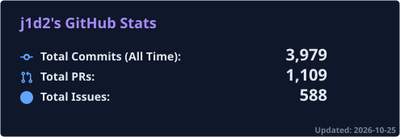
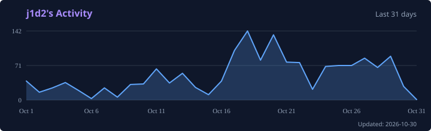

# 👋 Hi, I'm JD (j1d2)

### Principal Engineer | AI Engineering, Cloud & Data

*GenAI, fine-tuning, harness engineering, and graph engineering*

---

## 🚀 About Me

I have **15+ years** across serverless architectures, Kubernetes, CI/CD, GitOps, and multi-cloud environments. My focus now is **AI engineering**: GenAI, model fine-tuning, harness engineering, and graph engineering.

Recently, I've been pioneering AI-driven workflows using the Anthropic API and platform, Claude Code, GitHub Copilot, Gemini, Grok, AWS Kiro, and Google Antigravity. On Anthropic that includes extended thinking, prompt caching, and tool use. That work also includes local models, embeddings, and agentic workflows on AWS Bedrock, Google's agent platform, and DigitalOcean's agent platform. Recent systems work includes Kubernetes-native Go and Rust.

## 💡 What I Do

<table>
<tr>
<td width="50%" valign="top">

### 🤖 AI & Machine Learning
GenAI, model fine-tuning, harness engineering, and graph engineering, plus agentic workflows and retrieval across the major APIs and coding-agent tools

### ☁️ Cloud Architecture
Designing scalable multi-cloud solutions across AWS, GCP, Azure, Alibaba, and DigitalOcean, including Kubernetes, serverless, and inference routing

### 🔧 DevOps & Automation
Creating robust CI/CD pipelines & GitOps workflows that streamline delivery

</td>
<td width="50%" valign="top">

### 💾 Data Engineering
Building real-time data platforms processing billions of events daily

### 📊 Observability & SRE
Monitoring, logging, and tracing with Prometheus, Grafana, Loki, Tempo, and Thanos

### 🚀 Innovation
Constantly exploring emerging technologies and pioneering new approaches

</td>
</tr>
</table>

## 🛠️ Tech Stack

### AI & ML Tools

### Cloud & Infrastructure

### Programming Languages

### DevOps & CI/CD

### Data & Databases

### Monitoring & Observability

## 📊 GitHub Activity

---

## 💻 Tech Expertise

| **Category** | **Technologies** |
|:---:|:---|
| 🤖 **AI/ML** | GenAI, model fine-tuning, harness engineering, graph engineering, OpenAI, Anthropic API, Claude Code, extended thinking, prompt caching, GitHub Copilot, Codex, Gemini, Grok, AWS Kiro, Google Antigravity, AWS Bedrock, Google ADK, DigitalOcean Gradient, OpenAI Agents SDK, LangChain, LangGraph, LlamaIndex, PyTorch, TensorFlow, Chroma, MCP, Ollama, SageMaker, Vertex AI |
| ☁️ **Cloud** | AWS, GCP, Azure, Alibaba Cloud, DigitalOcean, Kubernetes, Terraform, CDK, Docker, Lambda, Cloud Run, Bedrock |
| 🔧 **DevOps** | GitHub Actions, GitLab CI, Jenkins, Flux, Crossplane, Argo CD, Helm, GitOps |
| 💾 **Data** | Snowflake, Redshift, PostgreSQL, CloudNativePG, DuckDB, Polars, MongoDB, Kafka, Airflow, DBT |
| 📊 **Observability** | Prometheus, Grafana, Loki, Tempo, Thanos, OpenTelemetry, Fluent Bit, ELK Stack, Jaeger, X-Ray, New Relic |
| 💻 **Languages** | Python, Go, Rust, C, JavaScript/Node.js, Bash, zsh |

## 🏆 Highlights

- 🏗️ **Architected** real-time reconciliation systems processing **billions of events daily**
- 🤖 **Pioneered** AI-driven workflows on the Anthropic API and platform (extended thinking, prompt caching, and tool use) plus Claude Code, GitHub Copilot, Gemini, Grok, AWS Kiro, and Google Antigravity, including local models, embeddings, and agentic workflows on AWS Bedrock and the Google and DigitalOcean agent platforms
- 🤖 **AI engineering** for GenAI, model fine-tuning, harness engineering, graph engineering, retrieval, embeddings, and inference routing across cloud and local models
- ☁️ **Led** multi-cloud migrations and hybrid cloud implementations
- 📊 **Built** observability with Prometheus, Grafana, Loki, Tempo, and Thanos, plus OpenTelemetry and Fluent Bit
- 🔧 **Automated** CI/CD and GitOps pipelines with Flux and Crossplane, reducing deployment time by **80%**

## 🌱 Currently Exploring

- Evaluation and cost control for model workloads
- Inference routing across cloud and local models
- Vector search and retrieval systems
- Platform engineering and internal developer platforms

## 📫 Let's Connect

- 🌐 Portfolio: [j1d2.me](https://j1d2.me)
- 🐙 GitHub: [j1d2](https://github.com/j1d2)
- 💼 Open to interesting projects and collaborations

---

